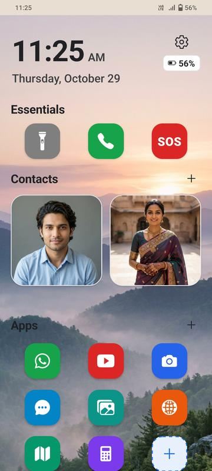
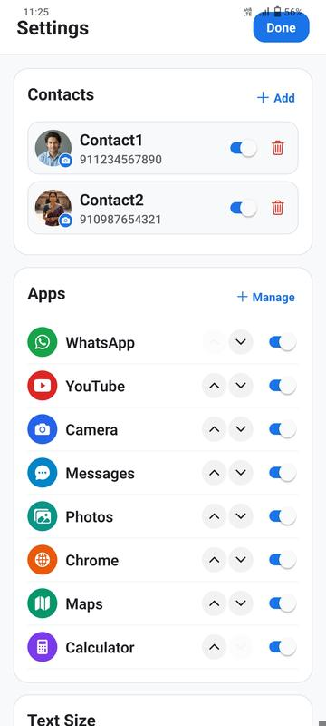
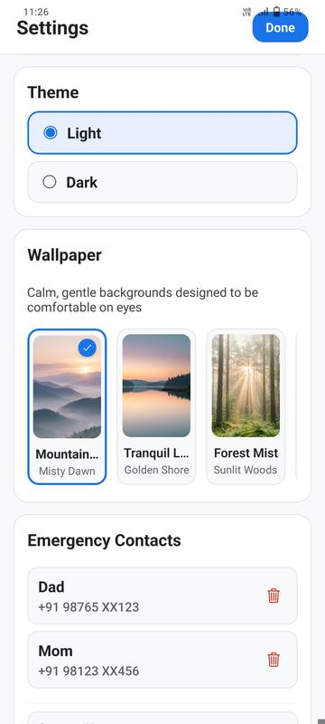
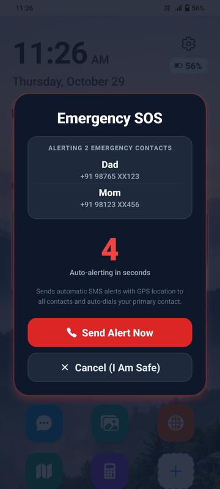
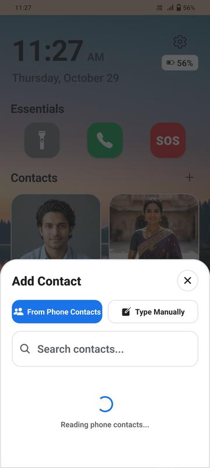
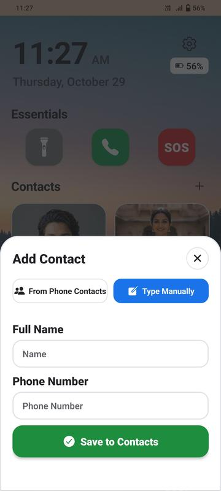

<h1 align="center">BigTap</h1>

<p align="center">
  
</p>

<p align="center">
  <b>A simple, distraction-free Android launcher designed for seniors and low-vision users.</b><br>
  <i>Big targets, high contrast, zero clutter, and reliable emergency safety.</i><br>
  <sub>Built with care for my grandparents — and shared freely for yours, too.</sub>
</p>

<p align="center">
  <a href="https://www.gnu.org/licenses/gpl-3.0"></a>
  
  
  
  
</p>

<p align="center">
  <a href="https://github.com/rakesh-pathuri/BigTap/releases/latest">
    
  </a>
</p>

> [!NOTE]
> **APK Sideloading & Security Verification:**  
> When installing the APK directly outside the Play Store, Android shows a standard confirmation for sideloaded apps. If Google Play Protect displays a prompt, tap **"More details"** ➔ **"Install anyway"**.  
> **Never disable Google Play Protect.** Instead, verify your download integrity against the official release checksum:  
> ```text
> SHA-256: e25bf98ceb3fcea934684dc0087a0b15d6dd2134ee10567dff5a5ca401804954
> ```
> *(Verify in PowerShell: `Get-FileHash bigtap-launcher.apk` or in Bash: `sha256sum bigtap-launcher.apk`)*  
> Releases are consistently signed, and official distribution via **F-Droid** and the **Google Play Store** is planned.

---

## Screenshots

<p align="center">
  
  &nbsp;
  
  &nbsp;
  
</p>
<p align="center">
  
  &nbsp;
  
  &nbsp;
  
</p>
<p align="center">
  
  &nbsp;
  
  &nbsp;
  
</p>

---

## Table of Contents

- [About BigTap](#about-bigtap)
- [Key Features](#key-features)
- [Tech Stack & Architecture](#tech-stack--architecture)
- [Dependencies](#dependencies)
- [Installation & Quick Start](#installation--quick-start)
- [Building the Release APK](#building-the-release-apk)
- [Android Permissions](#android-permissions)
- [Troubleshooting Guide](#troubleshooting-guide)
- [Contributing](#contributing)
- [License](#license)

---

## About BigTap

Modern smartphones are often too complex for elderly parents and grandparents. Accidental swipes, small fonts, buried settings, and hidden dialers make everyday phone use frustrating.

**BigTap** replaces the standard home screen with an accessible, high-legibility interface:
- **Big Buttons:** Large squircle tiles that are easy to see and tap.
- **One-Tap Calling:** Speed-dial family and emergency contacts with a single press.
- **Always-at-Top Navigation:** The screen automatically resets scroll position to the top whenever returning from another app.
- **Dignified Design:** Clean, modern, and accessible without feeling childish or patronizing.

---

## Key Features

- **Essentials Bar:**
  - **Flashlight / Torch:** Instant hardware torch toggle using the device flash.
  - **Phone:** Quick launch to the native dialer (with a built-in big dialpad fallback).
  - **Emergency SOS:** Single-tap emergency sequence that captures live GPS coordinates and dispatches direct background SMS alerts to all family contacts with real-time carrier confirmation.
- **Speed-Dial Photo Contacts:**
  - Large photo or color-initial tiles for loved ones.
  - 1-tap direct calling with haptic confirmation.
  - Customizable contact photos via gallery or camera.
- **Curated Apps Grid:**
  - Displays only essential, caregiver-selected applications (WhatsApp, YouTube, Camera, Calculator, Messages, etc.).
  - Includes a built-in accessible **Calculator** and clean **YouTube** modal.
- **Eye-Friendly Scenic Wallpapers:**
  - Soft nature landscapes tailored to reduce eye strain:
    - *Mountain Sunrise* (Misty morning dawn)
    - *Tranquil Lake* (Golden hour shore)
    - *Forest Mist* (Soft woodland sunbeams)
    - *Lavender Sunset* (Warm lavender fields)
    - *Solid Clean* (Minimal plain background)
- **Time & Battery Glance:**
  - High-visibility clock with full date display.
  - Horizontal battery indicator and charging status.
- **Caregiver Controls & Customization:**
  - Add or remove speed-dial contacts directly with custom photos or initials.
  - Manage the home app grid by toggling installed app visibility.
  - Configure emergency phone numbers and personalized SOS message text.
  - Switch themes (Light / Dark) and adjust interface font sizing (Normal, Large, Extra Large).

---

## Tech Stack & Architecture

- **React Native 0.88 & Expo SDK 58** (Bare workflow with Continuous Native Generation).
- **TypeScript** for strict type safety across the entire application.
- **DirectSmsModule (`modules/direct-sms`)**: Custom native Kotlin module that uses Android's `SmsManager` and `CameraManager` for background SMS dispatch and hardware torch control.
- **AsyncStorage**: Fast local persistence for contacts, wallpapers, and caregiver settings.

---

## Dependencies

| Package | Version | Purpose |
| :--- | :--- | :--- |
| `expo` | `~58.0.20` | Core runtime and Expo build system |
| `react-native` | `0.88.0` | Mobile application framework |
| `@expo/vector-icons` | `^15.0.2` | Vector icons (Ionicons, FontAwesome5) |
| `@react-native-async-storage/async-storage` | `2.2.0` | Persistent local storage for user settings |
| `expo-battery` | `~58.0.3` | Real-time device battery level and charging state |
| `expo-contacts` | `~58.0.9` | Contact picker for speed-dial setup |
| `expo-haptics` | `~58.0.7` | Tactile vibration feedback on button presses |
| `expo-image-picker` | `~58.0.10` | Custom contact avatar photo selection |
| `expo-intent-launcher` | `~58.0.3` | Native Android intent launcher for system settings |
| `expo-location` | `~58.0.19` | GPS coordinates for emergency SOS SMS |
| `expo-network` | `~58.0.4` | Network connection status detection |

---

## Installation & Quick Start

### Prerequisites
- [Node.js](https://nodejs.org/) (v20+ recommended)
- Java Development Kit (JDK 17)
- Android SDK & Android Studio (with build-tools 34+)

### Commands

1. **Clone the repository:**
   ```bash
   git clone https://github.com/rakesh-pathuri/BigTap.git
   cd BigTap
   ```

2. **Install dependencies:**
   ```bash
   npm install
   ```

3. **Verify typecheck, linting, and unit tests:**
   ```bash
   # TypeScript type check
   npx tsc --noEmit

   # Lint check
   npm run lint

   # Run Jest unit tests
   npm test
   ```

4. **Run on a connected Android phone or emulator:**
   ```bash
   npx expo run:android
   ```

---

## Building the Release APK

To generate a standalone release APK for testing or distributing:

```bash
cd android
./gradlew assembleRelease -g D:\.gradle --no-daemon
```

*(On Windows PowerShell, run `.\gradlew.bat assembleRelease`)*

The compiled release APK will be located at:
```text
android/app/build/outputs/apk/release/app-release.apk
```

---

## Android Permissions

BigTap requires only the permissions needed for safety and senior care:

| Permission | Reason |
| :--- | :--- |
| `android.permission.READ_CONTACTS` | Lets caregivers easily pick speed-dial contacts from the device phonebook. |
| `android.permission.SEND_SMS` | Dispatches direct emergency SMS alerts with GPS coordinates to family contacts. |
| `android.permission.ACCESS_FINE_LOCATION` | Appends current GPS coordinates to emergency SMS messages. |
| `android.permission.FLASHLIGHT` | Enables the one-touch hardware flashlight. |
| `android.permission.VIBRATE` | Provides accessible haptic feedback on button taps. |

---

## Troubleshooting Guide

### 1. Incoming calls not appearing (Vivo / Funtouch OS / MIUI)
- **Reason:** Some customized Android skins (e.g. Funtouch OS 9/10, MIUI) block Heads-Up Notifications (HUN) if an activity is not explicitly marked as a pure launcher.
- **Fix:** BigTap includes both `<category android:name="android.intent.category.HOME" />` and `<category android:name="android.intent.category.DEFAULT" />` with `adjustPan` soft input mode and no global window overlays.
- **Device setting:** Go to **Settings > More Settings > Applications > Default app settings > Home screen** and select **BigTap**. On Vivo devices, also grant **Autostart** in iManager.

### 2. Flashlight does not toggle
- **Reason:** The camera hardware might be temporarily locked by another app (like the native camera).
- **Fix:** Close any background camera apps, or tap the Torch button twice to rebind the hardware torch via `CameraManager`.

### 3. Emergency SMS Permissions
- **Reason:** Android requires runtime permissions (`SEND_SMS` and `ACCESS_FINE_LOCATION`) to send background SMS alerts with GPS coordinates.
- **Fix:** BigTap prompts for these permissions at runtime when SOS is activated. If previously denied, grant them in **Settings > Apps > BigTap > Permissions**.

### 4. Gradle build failure: `Duplicate resources`
- **Fix:** Ensure there are no duplicate `.png` and `.webp` launcher icons with the same name in `android/app/src/main/res/mipmap-*`. Clean the build directory before rebuilding:
  ```bash
  cd android
  ./gradlew clean
  ```

### 5. Google Play Protect sideload prompt
- **Reason:** BigTap uses `SEND_SMS` and `ACCESS_FINE_LOCATION` to dispatch instant SOS messages with GPS coordinates to family contacts. Play Protect prompts for confirmation when any app requesting SMS permissions is sideloaded directly outside the Play Store.
- **Verification:** Do not disable Play Protect. Simply verify that the downloaded APK's SHA-256 checksum matches the official release hash published in this repository, then tap **"More details"** ➔ **"Install anyway"**.

---

## Contributing

Contributions are warmly welcome! If you would like to help improve BigTap:

1. Fork the repository.
2. Create your feature branch (`git checkout -b feature/NewFeature`).
3. Commit your changes (`git commit -m 'Add NewFeature'`).
4. Push to the branch (`git push origin feature/NewFeature`).
5. Open a Pull Request.

Please ensure `npx tsc --noEmit` and `npx expo lint` pass with zero errors before submitting.

---

## License

This project is licensed under the **GNU General Public License v3.0 (GPLv3)**.

You are free to use, modify, and distribute this software under the terms of the GNU General Public License as published by the Free Software Foundation. See the [LICENSE](LICENSE) file for the full license text.

---

<p align="center">
  <b>Built with care for my grandparents — and shared freely for yours, too.</b><br>
  <sub>If BigTap helps someone you love stay connected, confident, and safe, consider starring the repository or sharing it with other families.</sub>
</p>
